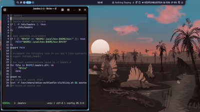

### Welcome to the Git World of Philip Collier 👋

Here is where I keep the core of my large and small computing projects.

- 🔭 I’m currently working on [Skywave Linux], a bootable live Linux environment for anonymous, global, and borderless access to over the air broadcast media.
- 🔭 I’m currently rebuilding [Catbird Linux] as an image based / atomic system, a Linux environment for deshittified and frictionless general purpose computing. That means content creation, web scraping, data analysis, writing, and note taking.
- 🔭 I’m currently working on [MOFO Linux], a bootable live Linux environment for anonymous, global, and borderless access to multimedia, forums, and cypher spaces.
- 🔭 I’m currently creating written content for [AB9IL.net] and videos for [Mach 7 Radio Intercepts].
- 👯 I am writing about [Atomic Linux], [KiwiSDR for online shortwave radio], [WebSDR for online shortwave radio], and [RTL-SDRs for airband radio].

 
 

[AB9IL.net]: https://www.ab9il.net
[Atomic Linux]: https://www.ab9il.net/book11/
[Mach 7 Radio Intercepts]: https://youtube.com/user/AB9IL
[KiwiSDR for online shortwave radio]: https://skywavelinux.com/book07/
[WebSDR for online shortwave radio]: https://www.ab9il.net/book10/
[RTL-SDRs for airband radio]: https://skywavelinux.com/book02/
[Skywave Linux]: https://skywavelinux.com
[Catbird Linux]: https://github.com/ab9il/catbirdlinux
[MOFO Linux]: https://sourceforge.net/projects/mofolinux/
